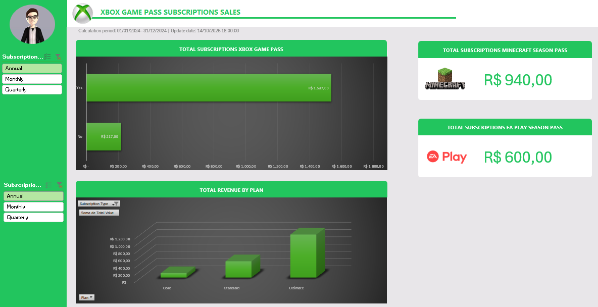

# Dashboard de Vendas de Assinaturas Xbox Game Pass em Excel

Dashboard interativo em Excel que responde a cinco perguntas de negócio sobre vendas de assinaturas Xbox Game Pass, usando Tabela do Excel, tabelas dinâmicas, gráficos dinâmicos e segmentações de dados.

## Índice

- [Visão geral](#visão-geral)
- [Organização da pasta de trabalho](#organização-da-pasta-de-trabalho)
- [Objetivos e perguntas de negócio](#objetivos-e-perguntas-de-negócio)
- [Ferramentas e recursos utilizados](#ferramentas-e-recursos-utilizados)
  - [Paleta de cores](#paleta-de-cores-aba-assets)
- [Demonstração visual](#demonstração-visual)
- [Como utilizar](#como-utilizar)
- [Competências demonstradas e melhorias futuras](#competências-demonstradas-e-melhorias-futuras)
  - [Competências demonstradas no projeto](#competências-demonstradas-no-projeto)
  - [Melhorias futuras](#melhorias-futuras)
- [Autor e contato](#autor-e-contato)

## Visão geral

O projeto foi construído integralmente em Excel. A base de dados reúne 295 assinantes com data de início entre 01/01/2024 e 16/12/2024, e traz plano (Core, Standard ou Ultimate), tipo de assinatura (Monthly, Quarterly ou Annual), renovação automática, passes adicionais (EA Play Season Pass e Minecraft Season Pass), valor de cupom e valor total.

A partir dessa base, a pasta de trabalho organiza as perguntas de negócio e suas análises em tabelas dinâmicas e apresenta as respostas em um painel visual, com filtros interativos.

- **Origem dos dados:** Dados Fictícios
- **Contexto de negócio e motivação do projeto:** Projeto desenvolvido durante o Bootcamp Santander- Excel com IA e Claude da DIO

### Organização da pasta de trabalho

| Aba | Função |
|---|---|
| Assets | Paleta de cores, logos e ícones usados no visual do dashboard |
| Bases | Base de dados em uma Tabela do Excel |
| Cálculos | Perguntas de negócio e tabelas dinâmicas que as respondem |
| Dashboard | Painel final com cards, gráficos e segmentações de dados |

No arquivo disponibilizado, as abas Assets, Bases e Cálculos estão ocultas e apenas a aba Dashboard está visível (veja [Como utilizar](#como-utilizar)).
| Coluna | Descrição |
|---|---|
| Subscriber ID | Identificador do assinante |
| Name | Nome do assinante |
| Plan | Plano contratado: Core, Standard ou Ultimate |
| Start Date | Data de início da assinatura |
| Auto Renewal | Renovação automática (Yes ou No) |
| Subscription Price | Preço da assinatura |
| Subscription Type | Tipo de assinatura: Monthly, Quarterly ou Annual |
| EA Play Season Pass | Contratação do passe EA Play (Yes ou No) |
| EA Play Season Pass Price | Preço do passe EA Play |
| Minecraft Season Pass | Contratação do passe Minecraft (Yes ou No) |
| Minecraft Season Pass Price | Preço do passe Minecraft |
| Coupon Value | Valor do cupom de desconto |
| Total Value | Valor total da assinatura |

Na base, `Total Value` é um valor fixo, sem fórmula. Nos 295 registros, ele é igual a Subscription Price + EA Play Season Pass Price + Minecraft Season Pass Price - Coupon Value.

## Objetivos e perguntas de negócio

O objetivo é transformar a base de assinaturas em respostas rápidas e visuais para perguntas de negócio documentadas na aba Cálculos.

| # | Pergunta de negócio (conforme documentada) | Onde aparece no dashboard |
|---|---|---|
| 1 | Qual o faturamento total de vendas de planos anuais (contendo todas as assinaturas agregadas)? | Total Geral da tabela dinâmica `tbl_annual_total` (aba Cálculos) |
| 2 | Qual o faturamento total de vendas de planos anuais, separado por auto renovação e não auto renovação? | Gráfico "Total Subscriptions Xbox Game Pass" |
| 3 | Qual o total de vendas de assinaturas do EA Play? | Card "Total Subscriptions EA Play Season Pass" |
| 4 | Qual o total de vendas de assinaturas do Minecraft Season Pass? | Card "Total Subscriptions Minecraft Season Pass" |
| 5 | Qual o faturamento total (Total Value) de cada plano de assinatura (Core, Standard e Ultimate)? | Gráfico "Total Revenue by Plan" |

## Ferramentas e recursos utilizados

| Recurso | Aplicação no projeto |
|---|---|
| Microsoft Excel [INFORMAR VERSÃO DO EXCEL] | Construção de toda a solução |
| Tabela do Excel | Base de dados `Tabela1` |
| Tabelas dinâmicas | Agregação do faturamento por renovação, por plano e por passe adicional |
| Gráficos dinâmicos | Visualizações do dashboard |
| Segmentação de dados | Filtro interativo por Subscription Type |
| Formas e imagens | Cards, cabeçalho, logos e ícones |

### Paleta de cores (aba Assets)

| Cor | Rótulo no arquivo |
|---|---|
| `#9BC848` | Xbox Color |
| `#22C55E` | Xbox Color |
| `#2AE6B1` | Menus |
| `#5BF6A8` | Menus |
| `#E8E6E9` | Negative zone |

## Demonstração visual

*Captura de tela do dashboard. Adicione o arquivo em `images/dashboard.png`.*

## Como utilizar

1. Baixe o arquivo `Dashboard.xlsx` deste repositório.
2. Abra no Microsoft Excel para computador. As segmentações de dados e os gráficos dinâmicos podem não ser exibidos corretamente em outros programas.
3. A aba **Dashboard** abre visível. Use as segmentações de Subscription Type na lateral esquerda para filtrar os indicadores.
   - A segmentação superior atua sobre as perguntas 1 a 4.
   - A segmentação inferior atua apenas sobre a pergunta 5 (gráfico "Total Revenue by Plan").
4. Para ver as abas ocultas (Assets, Bases e Cálculos), clique com o botão direito em uma aba e escolha **Reexibir**.
5. Para atualizar os dados:
   - Edite ou acrescente linhas em `Tabela1`, na aba Bases.
   - Clique em **Dados > Atualizar Tudo**.

## Competências demonstradas e melhorias futuras

### Competências demonstradas no projeto

- Organização de uma base em Tabela do Excel como fonte única de análise.
- Tradução de perguntas de negócio em análises com tabelas dinâmicas.
- Conexão de segmentações de dados a tabelas dinâmicas e gráficos.
- Construção de um painel com identidade visual definida e documentação das perguntas na própria pasta de trabalho.

### Melhorias futuras

- Análise da evolução mensal de assinaturas e faturamento pela data de início.
- Análise do impacto dos cupons por plano.
- Ticket médio por plano e taxa de renovação automática por plano.
- Rótulos mais claros para as duas segmentações de dados e para os títulos dos cards.
- Data de atualização do cabeçalho alimentada por dados, em vez de texto fixo.

## Autor e contato

- **Autor:** Kauã Castro
- **LinkedIn:** [https://www.linkedin.com/in/kauã-castro]
